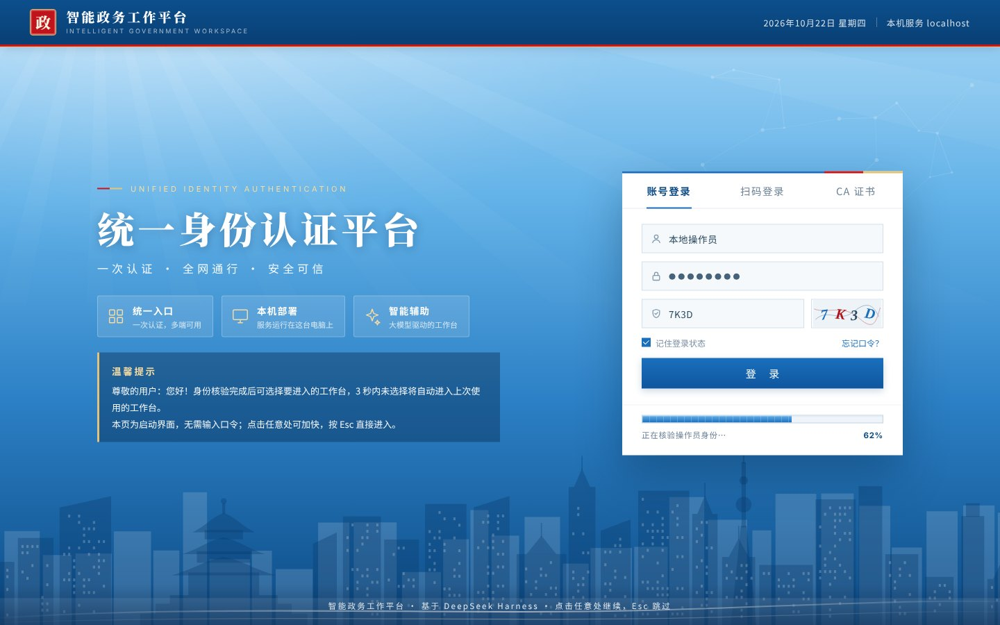
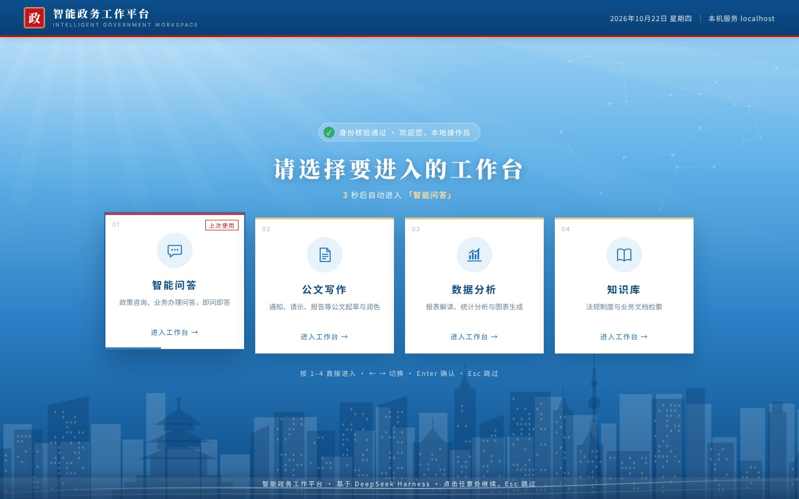
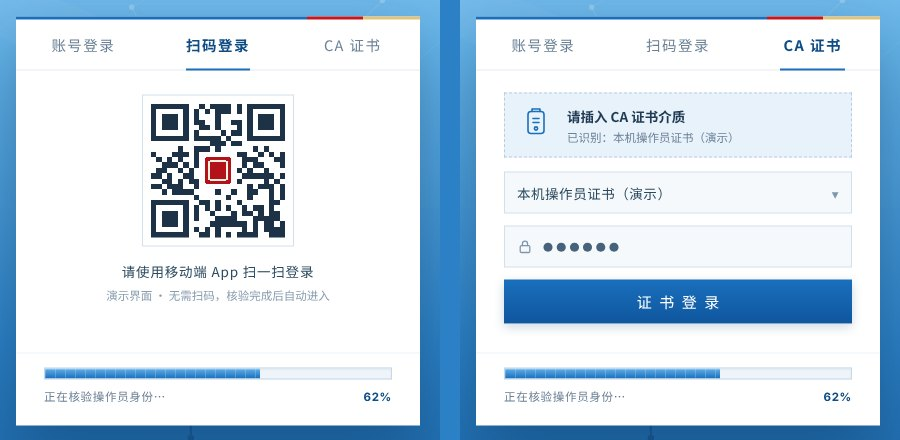
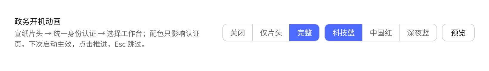
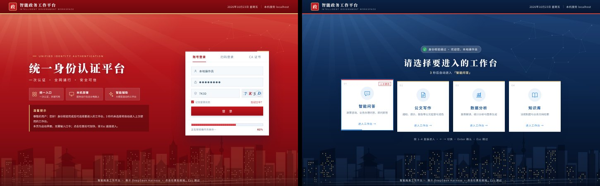

# dsh-gov-boot

[](https://github.com/okiexia-ui/dsh-gov-boot/actions/workflows/ci.yml)
[](LICENSE)
[](#安装)

中文 | [English](README.en.md)

给 DeepSeek Harness 的**政务风开机动画**：宣纸底朱红大字的长城片头 → 科技蓝统一身份认证（账号 / 扫码 / CA 证书三种登录方式）→ 选择要进入的工作台，选中后直接新建会话、把对应的提示词填进输入框。档位、配色、文字和提示词都能在设置里改。

**下载**：[dsh-gov-boot.tgz](https://github.com/okiexia-ui/dsh-gov-boot/releases/latest/download/dsh-gov-boot.tgz)（始终是最新版，历史版本见 [Releases](https://github.com/okiexia-ui/dsh-gov-boot/releases)），装法见下面「安装」。


## 流程

| 阶段 | 时长 | 内容 |
| --- | --- | --- |
| 片头 | 约 3 秒 | 回纹金框 → 朝阳、祥云、远山浮起 → 长城沿山脊自左向右展开 → 标题宋体大字揭幕 → 朱文印章落下、底部红绸 |
| 认证 | 约 2.8 秒 | 左侧大标题与温馨提示，右侧登录卡；百分比进度条 14% → 38% → 62% → 86% → 100% |
| 选择工作台 | 默认 3 秒倒计时 | 智能问答 / 公文写作 / 数据分析 / 知识库四张卡片，默认是上次用过的那张 |
| 交接 | 约 0.6 秒 | 整屏淡出，进入 DSH |

- **「自动」档（默认）**：每个版本第一次启动放完整版，之后只放约 3 秒的片头；升级后会再放一次完整版
- **进度条最后一段是真的**：走到 86% 会停下来，等 DSH 自己的启动卡片消失（应用真正就绪）再走到 100%；最多等 10 秒
- **选中工作台会真的做事**：点卡片、按 `1`–`4` 或按 `Enter` 确认后，插件通过 DSH 自己的「新建会话」接口在最近用的工作区里打开一个会话（有空白会话就复用），把这张卡的提示词填进输入框——**只填不发**。倒计时自动进入、按 Esc 跳过都不会新建会话；还没有工作区时什么也不做。设置里可以关掉
- **三种登录方式**：登录卡顶部可以切换「账号登录 / 扫码登录 / CA 证书」，只是界面展示，不需要也不会读取任何口令，二维码不可扫
- **点击 / Enter** 一步一步往前推；**Esc** 随时跳过全部
- **按键不会漏给后面的应用**：遮罩在的时候，打字、Enter、Tab 都被拦下；带 ⌘ / Ctrl / Alt 的快捷键照常生效
- **减少动态效果**：系统开了「减少动态效果」时，每一拍照常出现，只是不再有位移和渐变
- **桌面端窗口照样能拖**：遮罩在时顶部 28px 是窗口拖动区
- 首帧由宿主半边在文档解析阶段注入，DSH 自己的 `HARNESS / Loading plugins…` 卡片不会露出来
- 纯 CSS/JS + 内联 SVG（长城、山峦、城市剪影都按固定种子生成），无图片、无音频、无网络请求
- 认证页和选择页在片头播放中途才构建：首帧挂载在 4 倍降速下约 25 ms，开场的 DOM 只有约 100 个节点







## 设置

设置 → 通用里多一行「政务开机动画」：



| 控件 | 作用 |
| --- | --- |
| 关闭 / 自动 / 仅片头 / 完整 | 关闭：直接进 DSH；自动：每个版本第一次放完整版，之后只放片头；仅片头：约 3 秒；完整：每次都放片头 + 认证 + 选择工作台（约 10 秒） |
| 科技蓝 / 中国红 / 深夜蓝 | 认证页和选择页的配色（片头始终是宣纸红金）；「关闭」「仅片头」时不可选 |
| 预览 | 不用重启，当场按当前配色完整播放一遍（「关闭」时也能预览；预览里选工作台不会新建会话） |
| 自定义… | 展开后可以改：片头标题（≤16 字）、副标题、印章文字（1–4 字）、倒计时（1–9 秒），四个工作台的名称、说明和预填提示词，以及「选中后新建会话并预填提示词」开关；「恢复默认」一键还原 |

都存在本机 `localStorage`（`dsh-gov-boot:mode` / `:theme` / `:app` / `:seen` / `:custom`），下次启动生效。



### 给开发者

每次进入工作台都会在 `document` 上派发 `dsh-gov-boot:enter` 事件，`detail` 是 `{ index, name, prompt, explicit }`（`explicit` 表示是用户亲手选的，而不是倒计时）。想接自己的逻辑可以监听它。

## 安装

### 从安装包（推荐）

下载 [dsh-gov-boot.tgz](https://github.com/okiexia-ui/dsh-gov-boot/releases/latest/download/dsh-gov-boot.tgz)，在 DSH 的「设置 → 插件 → 安装」里填它的绝对路径，例如：

```
/Users/你的用户名/Downloads/dsh-gov-boot.tgz
```

或者用宿主 RPC：

```bash
curl -X POST http://127.0.0.1:55988/api/pluginManager/installBundle \
  -H "Cookie: <dsh-auth cookie>" -H "Content-Type: application/json" \
  -d '{"type":"client-request","rpcId":"i","method":"pluginManager/installBundle","payload":{"args":{"spec":"/绝对路径/dsh-gov-boot.tgz","options":{"enabled":true}}}}'
```

### 从源码目录

设置 → 插件 → 安装，填 `link:/你的/源码/目录/dsh-gov-boot`。

### 命令行（非桌面端 profile）

```bash
dsh plugin --profile web add /绝对路径/dsh-gov-boot.tgz
```

安装后**完全退出**客户端（⌘Q），重新打开生效。

> 官方桌面端独占 `desktop` profile，命令行 `dsh plugin --profile desktop` 会被拒绝；桌面端请用「设置 → 插件」。

## 预览

浏览器直接打开 [`preview/index.html`](preview/index.html)，它用假的 `__ModuleLoader__` 加载真正的 `lib/client.js`。左下角工具条可以重播、切换档位和配色。

| 参数 | 作用 |
| --- | --- |
| `?seek=2900` | 定格在片头 |
| `?seek=4400` | 定格在认证页（62%） |
| `?seek=6400` | 定格在选择工作台 |
| `&tab=qr` / `&tab=ca` | 认证页切到扫码 / CA 证书 |
| `&theme=red` / `&theme=night` | 换配色 |
| `&mode=splash` | 只放片头 |

## 想改代码

源码在 `src/`，`npm run build` 把它们拼成 DSH 直接加载的 `lib/client.js`。

| 想改的东西 | 位置 |
| --- | --- |
| 默认标题、印章、工作台、提示词 | `src/constants.js` 的 `DEFAULTS` |
| 长城走势、烽火台、城市剪影、二维码 | `src/art.js` |
| 片头和认证页的文案、结构 | `src/markup.js` |
| 三套配色、动画 | `src/style.js`（`.gb-root[data-theme=…]` 那三段变量） |
| 时间线、按键、进度节奏 | `src/overlay.js` |
| 选中工作台后做什么 | `src/actions.js` |
| 设置行 | `src/settings.js` |
| 首帧底色 | `lib/index.js` 的 `FIRST_FRAME_BG`（必须与纸色 `#f6efe2` 一致） |

版本号只写在 `package.json` 里：宿主半边启动时读它，再注入给客户端。

## 关掉或卸载

- 临时关闭：设置 → 通用 →「政务开机动画」选「关闭」，或者在控制台执行 `localStorage.setItem('dsh-gov-boot:mode','off')`，重启生效
- 卸载：设置 → 插件 → 已安装 → 移除 `dsh-gov-boot`，重启

## 结构

```
lib/index.js      宿主半边：webserver/index-inject 注入首帧 CSS/脚本 + 版本
lib/client.js     客户端半边（由 src/ 生成）：片头、认证页、选择工作台、设置行
src/              客户端源码，按职责分成 9 个文件
preview/          独立预览页（加载真实 client.js）与截图
test/             约定测试、无头浏览器端到端测试、真实 DSH 测试
scripts/          构建、截图、演示动图
docs/             演示动图、图标、插件目录条目
cordis.patch.yml  把宿主半边挂进 profile 的 bundle patch
```

## 说明

- 画面里没有国徽、党徽、国旗等受法律保护的标志；印章是装饰性的方形朱文印，不仿公章样式
- 认证页上的「核验」是启动画面的一部分，并不做真正的身份验证；页面上的温馨提示也写明了这一点
- 字体使用系统自带的 Songti SC / PingFang SC / Kaiti SC（Windows 上回退到宋体 / 微软雅黑 / 楷体），不内嵌字体文件
- 已在 DeepSeek Harness 0.2.1-rc.2 的 Web 端实测：首帧、设置行（浅色 / 深色）、预览、选中工作台后预填提示词；CI 每次都会重新跑一遍

## 路线图

- [x] 认证页和选择页推迟到片头播放中再构建（0.5.0）
- [x] 城市窗户、二维码合并成单个 `<path>`，开场 DOM 从约 1100 个节点降到约 100 个（0.5.0）
- [x] 「自动」档：每个版本第一次放完整版，之后只放片头（0.5.0）
- [x] 在设置里自定义标题、印章文字、倒计时、四个工作台和提示词（0.5.0）
- [x] 选中工作台后新建会话并预填提示词（0.5.0）
- [x] CI 里跑真实的 DSH（0.5.0）
- [ ] 英文界面
- [ ] 工作台卡片可以绑定 DSH 的 Agent 预设
- [ ] 发布到 npm，进入 DSH 插件市场

想认领哪一条，开个 issue 说一声就行。

## 参与贡献

欢迎 issue 和 PR。开发环境、测试命令和约定见 [CONTRIBUTING.md](CONTRIBUTING.md)，简单说：

```bash
npm install && npx playwright install chromium
npm run build       # src/ → lib/client.js
npm test            # 语法 + 约定检查
npm run test:e2e    # 无头浏览器跑完整流程
npm run test:dsh    # 在真实的 DSH 里跑（需要 npm i -g @deepseek-ai/dsh pnpm）
```

参与即表示同意遵守 [行为准则](CODE_OF_CONDUCT.md)；安全问题请按 [SECURITY.md](SECURITY.md) 私下报告。

## 许可与致谢

MIT。首帧遮挡、设置行与桌面端拖动区的做法参考了 [dsh-550c-boot](https://github.com/yannicksong0106/dsh-550c-boot)（MIT © Ziyang Song），许可原文一并附在 [LICENSE](LICENSE) 里。
